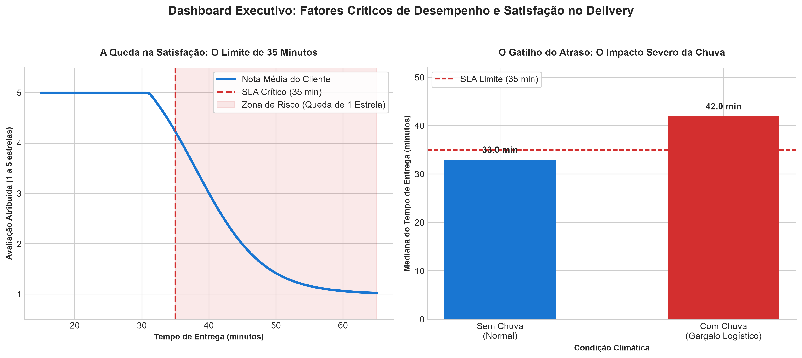

# O limite de 35 minutos e o gargalo da chuva: diagnóstico operacional e estratégico do app de delivery (2024)

> O controle do tempo de entrega (SLA) é o principal pilar de satisfação do cliente, exigindo a criação de protocolos preditivos de mitigação em dias de chuva e o uso de cupons estritamente como alavanca de aquisição (growth).



*Dashboard Executivo. Esquerda: Limiar crítico de tempo e queda na nota. Direita: Impacto do clima no tempo de entrega. Amostra: 8.058 pedidos, 2024.*

---

## 1. Pergunta de negócio

A diretoria do aplicativo de delivery solicitou este diagnóstico dos dados de 2024 para embasar o planejamento orçamentário e estratégico de 2025. O estudo investigou três frentes principais: a **operação** (o que dita o ritmo e os atrasos das entregas), os **clientes** (comportamento de gasto e fatores que derrubam a satisfação) e as **alavancas comerciais** (o real impacto da chuva e a eficiência das campanhas de cupons).

**Perguntas que guiaram a análise:**
1. Em quais horários e dias da semana se concentram os maiores volumes de pedidos?
2. Quais fatores operacionais (como chuva e distância) mais impactam o tempo de entrega?
3. O perfil de gasto (ticket mediano) muda de acordo com o tipo de culinária escolhida?
4. Qual é o impacto exato do tempo de espera na nota de avaliação deixada pelo cliente?
5. As campanhas de desconto (como o "Julho de cupons") servem para fidelizar a base ou para adquirir novos usuários?

## 2. Dados

- **Fonte:** `delivery_pedidos.csv`, fornecida no módulo DS-PY-018 (dados simulados de um app de delivery).
- **Período e escopo:** 01/01/2024 a 31/12/2024; operações centralizadas em São Paulo, Rio de Janeiro e Belo Horizonte.
- **Tamanho:** 8.058 linhas × 18 colunas (base original) → 8.058 linhas × 20 colunas (base limpa, adicionando extrações temporais).
- **Unidade de observação:** Um pedido único.

### Dicionário da base limpa (`saidas/delivery_pedidos_limpo.csv`)

| Coluna | Tipo | Descrição | % faltantes | Observação / tratamento |
|---|---|---|---|---|
| `pedido_id` | int64 | Identificador único do pedido | 0.0% | Único para cada linha |
| `data_hora` | datetime | Data e hora exata da transação | 0.0% | Convertida de string para datetime |
| `cidade` | object | Cidade onde ocorreu a entrega | 0.0% | 13 variantes textuais padronizadas para 3 nomes corretos |
| `bairro` | object | Bairro do cliente | 0.0% | Mantido no original |
| `restaurante_id` | object | Identificador da loja parceira | 0.0% | Mantido no original |
| `tipo_cozinha` | object | Categoria culinária (Hambúrguer, etc.) | 0.0% | Mantido no original |
| `plataforma` | object | Sistema usado (iOS, Android, Web) | 0.0% | Valores nulos preenchidos com "Desconhecido" |
| `forma_pagamento` | object | Método de pagamento escolhido | 0.0% | Múltiplas variantes agrupadas em 4 categorias oficiais |
| `cupom` | bool | Se o pedido teve aplicação de cupom | 0.0% | Textos ("Sim"/"Não") convertidos para Booleano |
| `cliente_novo` | bool | Flag do sistema para primeira compra | 0.0% | Mantido no original |
| `chuva` | bool | Condição climática do dia na cidade | 0.0% | Mantido no original |
| `distancia_km` | float64 | Distância linear do restaurante ao cliente | ~3.91% | Valores > 100km passados para NaN (Outlier tratado) |
| `tempo_entrega_min` | float64 | Tempo total em minutos (Preparo + Rota) | ~0.40% | Valores negativos e "999" passados para NaN |
| `valor_pedido` | float64 | Ticket do carrinho sem a taxa de entrega | 0.0% | Texto "R$" removido e vírgula trocada por ponto |
| `taxa_entrega` | float64 | Valor cobrado pelo frete | 0.0% | Mantido no original |
| `avaliacao` | float64 | Nota dada de 1 a 5 | ~16.65% | Faltantes mantidos (viés de seleção do cliente) |
| `data` | object | Data isolada (AAAA-MM-DD) | 0.0% | Coluna derivada de `data_hora` |
| `mes` | int32 | Mês do pedido (1 a 12) | 0.0% | Coluna derivada de `data_hora` |
| `hora` | int32 | Hora do pedido (0 a 23) | 0.0% | Coluna derivada de `data_hora` |
| `dia_semana` | category | Dia da semana ordenado (Seg a Dom) | 0.0% | Coluna derivada de `data_hora` |

## 3. Como rodar

```bash
git clone [INSERIR URL DO SEU REPOSITORIO]
cd [nome-da-pasta]
python -m venv .venv && source .venv/bin/activate     # Windows: .venv\Scripts\activate
pip install -r requirements.txt
jupyter notebook projeto_final.ipynb
```

- O notebook fará a leitura da base bruta em `./dados/delivery_pedidos.csv`. Garanta que a pasta de dados esteja na mesma hierarquia do script.
- Execute **Kernel → Restart & Run All**. O processamento dos testes e a geração das figuras levará cerca de 15 segundos (a depender do hardware local).
- Versões documentadas utilizadas neste ambiente: `pandas`, `numpy`, `scipy`, `matplotlib`, `seaborn`, `python-docx` e `python-pptx` (detalhadas no `requirements.txt`).

## 4. Estrutura do repositório

```
.
├── README.md                     ← Este arquivo de relatório
├── LICENSE                       ← Licença de uso e compartilhamento do trabalho MIT
├── requirements.txt              ← Dependências do Python
├── projeto_final.ipynb           ← Notebook com a análise exploratória (Etapas 1 a 11)
├── dados/
│   └── delivery_pedidos.csv      ← Base de dados bruta (imutável)
├── notebooks/
│   └── projeto_final.ipynb       ← Notebook com a análise exploratória (Etapas 1 a 11)
└── saidas/
    ├── delivery_pedidos_limpo.csv            ← Base higienizada
    ├── dicionario_dados_limpo.csv            ← Dicionário descritivo em tabular
    ├── figura_principal.png                  ← Dashboard executivo
    ├── Apresentação Executiva.pdf            ← Apresentação executiva em Slides
	└── Glossário Estatístico do Projeto.pdf  ← Glossário com os termos utilizados no projeto
```

## 5. Metodologia

1. **Perguntas e hipóteses** — Formulação de problemas de negócio voltados à ação estratégica da diretoria.
2. **Carga e inspeção** — Identificação de formatos corrompidos de data e moeda, variações textuais e 16% de faltantes em notas.
3. **Limpeza** — Uso de regex, mapeamento de strings e conversões paramétricas para transformar `valor_pedido` e unificar categorias.
4. **Outliers** — Separação de "erros de sistema" (ex: tempo negativo) de "extremos legítimos" (pedidos corporativos massivos).
5. **Estatística descritiva** — Análise da assimetria do ticket para justificar uso de medianas em detrimento das médias.
6. **Sumarização e granularidade** — Recorte temporal (horário de pico noturno/fim de semana) e análise comparativa por praça.
7. **Visualização** — Criação de gráficos estilizados evidenciando a relação entre SLA e NPS/Satisfação.
8. **Correlação** — Observação da matriz de Spearman (imune a outliers) mostrando a correlação negativa (tempo x nota).
9. **Testes de hipótese** — Aplicação rigorosa de testes não-paramétricos (Mann-Whitney e Kruskal-Wallis) isolando variáveis.
10. **Conclusões** — Mapeamento do impacto da chuva e do cupom; elaboração de 3 planos acionáveis.

### Decisões Críticas de Limpeza e Outliers

| Problema | Linhas afetadas | Decisão | Alternativa considerada |
|---|---|---|---|
| `tempo_entrega_min` = 999 ou < 0 | ~25 linhas | Substituído por `NaN` + Flag de inválido | Remover as linhas (perderia faturamento da operação) |
| `distancia_km` > 100km | ~194 linhas | Substituído por `NaN` + Flag de inválido | Remover as linhas ou usar Regressão para prever |
| `valor_pedido` corporativo (>R$ 600) | ~31 linhas | Mantidos intactos na base, mas com flag para isolá-los na análise descritiva | Exclusão total ou Winsorização (amassamento dos picos) |
| Cidades e Pagamentos despadronizados | Diversas | Uso de `.map()` com dicionário para unificação | Substituição manual propensa a erro |

## 6. Principais achados

1. **A barreira crítica dos 35 minutos.** O atraso superior a 35 minutos diminui a satisfação do cliente em 1,00 estrela inteira na mediana (Teste Mann-Whitney).
2. **O gargalo logístico da chuva.** Operações em dias chuvosos elevam o tempo de entrega na plataforma em +9,0 minutos, com tamanho de efeito gigante (Cohen's d: 0.89).
3. **A alavanca invisível dos cupons.** A aplicação promocional não ocorre ao acaso; ela possui altíssima associação com o cadastro de clientes novos (Teste Qui-Quadrado Estratificado).
4. **A força do tipo de cozinha no Ticket.** A categoria culinária é a grande condutora de preço, explicando isoladamente mais de 40% de toda a variação de preço na plataforma (Kruskal-Wallis).
5. **Comportamento homogêneo de pagamento.** A preferência por formas de pagamento (Pix, Cartão) independe geograficamente da cidade; há um padrão global no app.

### Hipóteses testadas (α = 5%)

| Hipótese Alternativa (H1) | Teste Utilizado | P-Valor | Efeito / Magnitude | Decisão | Em linguagem de negócio |
|---|---|---|---|---|---|
| H1: Chuva impacta o tempo de entrega | Mann-Whitney U | ~0.000 | +9.0 min (Cohen's d: 0.89) | **Rejeita H0** | A chuva causa atrasos severos na operação. |
| H2: Uso de cupom altera o ticket final | Mann-Whitney U | ~0.000 | R$ -5.60 (Cohen's d: -0.08) | **Rejeita H0** | Impacto estatístico, mas com irrelevância comercial. |
| H3: Tempo afeta a nota do cliente | Mann-Whitney U + Spearman | ~0.000 | -1.00 estrela na mediana | **Rejeita H0** | Atraso maior que 35min afunda a reputação da marca. |
| H4: Ticket difere entre cozinhas | Kruskal-Wallis + ANOVA | ~0.000 | Epsilon-squared: 0.4058 | **Rejeita H0** | A culinária escolhida explica os picos de preço. |
| H5: Pagamento depende da cidade | Qui-Quadrado de Independência | 0.6951 | V de Cramér: 0.0155 | **Falha H0** | A adoção de Pix/Cartão é nacional e unificada. |
| H6: Uso de Cupom mira Cliente Novo | Qui-Quadrado (Controle Mantel-Haenszel) | ~0.000 | V de Cramér: 0.2320 | **Rejeita H0** | Cupons funcionam ativamente como canal de aquisição. |

## 7. Recomendações

| # | Recomendação | Achados que sustentam | Métrica para acompanhar |
|---|---|---|---|
| 1 | **Alerta Climático Preventivo:** Dilatar as estimativas no app e reforçar rotas em dias chuvosos. | H1 (Chuva atrasa +9min) e H3 (SLA > 35min derruba nota) | % de pedidos entregues em $\le 35$ min em dias chuvosos (Meta: >75%). |
| 2 | **Foco de Margem Promocional:** Restringir cupons gordos estritamente a novos clientes no funil. | H6 (Cupons estão fortemente ligados à aquisição). | CAC Promocional e Taxa de Retenção de 2ª compra. |
| 3 | **Combos de Categoria:** Incentivar agrupamento de itens complementares nas cozinhas baratas (Doces). | H4 (Cozinha dita a variação do ticket médio em 40%). | AOV (Average Order Value) segmentado por Vertical. |

## 8. Limitações

- **Causalidade Restrita:** Como trabalhamos com dados puramente observacionais (sem testes A/B aleatórios), variáveis ocultas (como trânsito de cada bairro) podem estar se misturando com a relação entre chuva e atraso.
- **Viés de Auto-Seleção:** Avaliações de 1 a 5 estrelas são dadas voluntariamente; normalmente a base capta os clientes muito felizes ou muito frustrados, negligenciando a massa de usuários neutros.
- **Opacidade Operacional:** O tempo de entrega é um bloco único. Não há informações separando o que foi lentidão no preparo da cozinha e o que foi lentidão do motoboy no asfalto.

## 9. Próximos passos

- Integrar a base com *timestamps* granulares operacionais (Hora Aceite -> Hora Retirada -> Hora Chegada) para isolar o gargalo da chuva (Restaurante ou Trânsito).
- Desenhar um Teste A/B rigoroso sorteando clientes antigos para ganhar cupons vs. não ganhar cupons, a fim de provar definitivamente a causalidade de incremento de receita.
- Adicionar uma base longitudinal com dados de 2022 e 2023 para mitigar efeitos anômalos que aconteceram unicamente em 2024.

## 10. Autores

| Nome | GitHub | Principais contribuições |
|---|---|---|
| Felipe | [@eufelipe10] | Escrita do projeto (Etapas 1 a 11), Modelagem de Dados, Automação do Relatório e Apresentação Executiva |

*Projeto final do módulo DS-PY-018 · Análise Exploratória de Dados · Caixaverso / Ada Tech (Novembro 2026)*

---